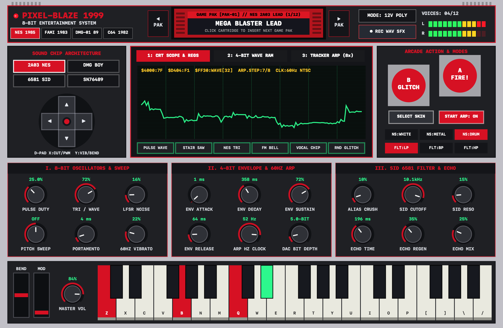
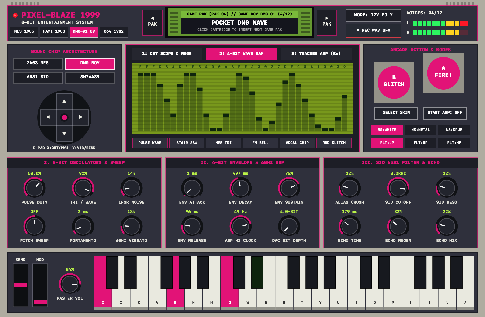
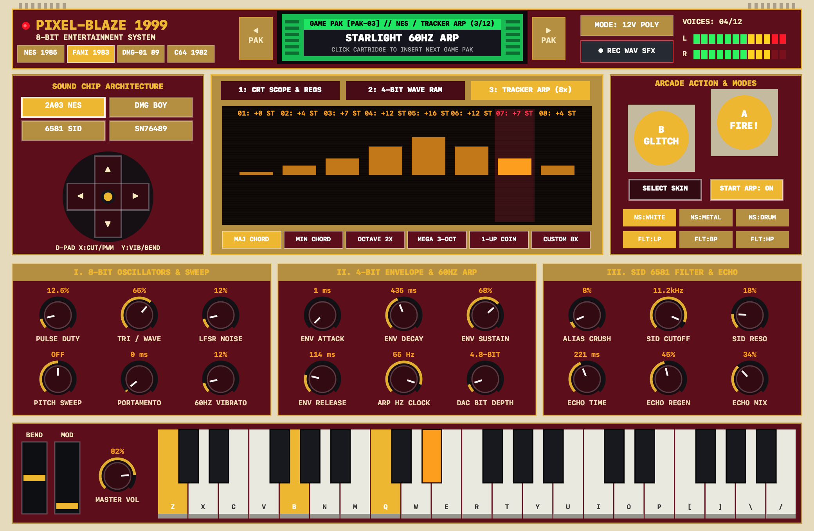
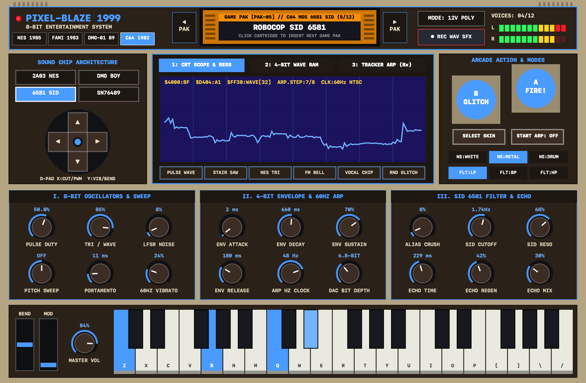

# PIXEL-BLAZE 1999 — Authentic 8-Bit Video Game Console VST3 & Standalone Synthesizer

**Pixel-Blaze 1999** is a hardware-authentic 8-bit chiptune synthesizer built as both a **Universal Binary macOS VST3 Instrument (`Pixel-Blaze 1999.vst3`)** for **FL Studio** and a **Native Standalone macOS Desktop Application (`Pixel-Blaze 1999.app`)** with CoreAudio, CoreMIDI, QWERTY keyboard playback, a built-in 8-bit arcade demo song player, and a 16-bit stereo `.WAV` recorder.



## 4 Switchable Console Hardware Skins & 3 Interactive Screen Modes

| Game Boy DMG-01 (`4-Bit Wave RAM Editor`) | Famicom 1983 (`8-Step 60Hz Tracker Arp`) | Commodore 64 (`MOS 6581 SID Mode`) |
| :---: | :---: | :---: |
|  |  |  |

---

## Key Features

### 1. Four Iconic 8-Bit Sound Chip Architectures
- **NES / Famicom (Ricoh 2A03)**:
  - Dual Pulse oscillators with hardware duty-cycle tables (`12.5%`, `25%`, `50%`, `75%` inverted), hardware pitch-sweep unit, and 4-bit (16-step) envelope stair-stepping.
  - 32-step 4-bit quantized Triangle wave (`15..0..15`) with authentic NES non-linear DAC mixer compression.
- **Game Boy (Sharp LR35902 / DMG-01)**:
  - Dual stereo-panned Pulse oscillators + interactive **32-step 4-bit Wave RAM (`$FF30-$FF3F`)** that you can draw directly on the console's center screen.
- **Commodore 64 (MOS 6581 / 8580 SID)**:
  - Continuous PWM Pulse + Sawtooth + Triangle + Ring Modulation routed into a non-linear **MOS 6581 State-Variable Resonant Filter (`LP / BP / HP`)**.
- **Sega Master System / ColecoVision (TI SN76489 PSG)**:
  - 3 detuned 50% Square wave generators + periodic/white shift-register noise.

### 2. Hybrid Polyphonic + 15-Bit LFSR Noise / Percussion Layer
- Switch between **12-Voice Polyphonic Mode** (play lush chiptune chords in FL Studio) and **Mono Chiptune Lead Mode** with fast portamento glide.
- Dedicated **15-Bit Linear Feedback Shift Register (LFSR)** noise & percussion layer with 3 modes:
  - **`NS:WHITE`**: 32,767-step shift register for classic 8-bit explosions, snares, and hi-hats.
  - **`NS:METAL`**: 93-step feedback tap (bit 6) for metallic robotic/zap/engine tones.
  - **`NS:DRUM`**: 8-bit DPCM pitch-drop kick + snare burst transient on every note attack.

### 3. Interactive Classic Console Hardware Interface
- **Top-Loading Game Pak Cartridge Slot Browser**: Click `< PAK`, `PAK >`, or the physical cartridge itself to swap between **12 Factory Game Pak Presets** (`MEGA BLASTER LEAD`, `SUNSOFT TRI BASS`, `STARLIGHT 60HZ ARP`, `POCKET DMG WAVE`, `ROBOCOP SID 6581`, `MASTER SYSTEM POLY`, `FAMICOM DISK BELL`, `BRINSTAR DEPTHS PAD`, `1-UP COIN & POWERUP`, `LASER & JUMP BLASTER`, `BOSS EXPLOSION SFX`, `PIXEL-BLAZE 1999`).
- **4 Switchable Console Hardware Skins**:
  - **`NES 1985`** (Light Gray & Charcoal Shell, Crimson Red A/B, Phosphor Green/Cyan CRT)
  - **`FAMI 1983`** (Cream Ivory & Deep Maroon Shell, Brushed Gold Faceplate, Amber CRT)
  - **`DMG-01 89`** (Putty Gray Shell, Slate Bezel, Wine/Magenta A/B, Classic Olive Dot-Matrix LCD)
  - **`C64 1982`** (Warm Breadbin Beige, Dark Brown Deck, Commodore 6581 Blue Monitor)
- **Center CRT / Dot-Matrix LCD Screen with 3 Interactive Modes**:
  1. **`1: CRT SCOPE & REGS`**: Real-time stair-stepped 8-bit oscilloscope + live hex chip registers (`$4000`, `$D404`, `$FF30`).
  2. **`2: 4-BIT WAVE RAM`**: Draw your own 32-step x 16-level (4-bit) custom waveform with the mouse, or pick from 6 quick wave generators (`PULSE`, `STAIR SAW`, `NES TRI`, `FM BELL`, `VOCAL CHIP`, `RND GLITCH`).
  3. **`3: TRACKER ARP (8x)`**: Interactive 8-step 50/60Hz Tracker Arpeggiator sequencer (`-12` to `+24` semitones per step) + 6 arp modes (`MAJ CHORD`, `MIN CHORD`, `OCTAVE 2X`, `MEGA 3-OCT`, `1-UP COIN`, `CUSTOM 8X`).
- **Interactive Physical D-Pad & Arcade Action Buttons**:
  - **D-Pad**: X/Y performance modulator (X sweeps Filter Cutoff & Pulse Duty; Y sweeps 60Hz Vibrato & Pitch Bend). Double-click to re-center.
  - **`B` Button (`GLITCH`)**: One-click musical 8-bit patch & wavetable glitch randomizer.
  - **`A` Button (`FIRE!`)**: Instant audition trigger button.
  - **`SELECT` & `START`**: Cycle Console Skins (`SELECT`) and toggle the 60Hz Tracker Arpeggiator (`START`).

---

## Building & Installing

```bash
./build.sh
```

- **VST3 Bundle for FL Studio**: `build/Pixel-Blaze 1999.vst3` (copy to `~/Library/Audio/Plug-Ins/VST3/` and scan in FL Studio via *Options -> Manage plugins -> Find installed plugins*).
- **Standalone macOS App**: `build/Pixel-Blaze 1999.app` (launch directly via `open "build/Pixel-Blaze 1999.app"`).
